# deck-builder

구현한 시스템의 코드베이스와 git 이력을 읽어 **데이터 흐름이 움직이는 애니메이션 토폴로지**가 들어간 발표 장표를 만들어 주는 Claude Code 플러그인입니다. 결과물은 브라우저로 바로 여는 HTML 파일 하나이고, 저장소 대신(또는 함께) HWPX·PDF·PPTX·DOCX 문서도 입력으로 받습니다.

- 코드에서 노드·간선·요청 흐름을 `파일:라인` 근거와 함께 뽑아 구성도를 자동으로 그립니다
- 청중에 맞는 이야기 틀을 고르고, 슬라이드 제목만 읽어도 주장이 이어지도록 제목 목록을 먼저 확인받은 뒤 장표를 만듭니다
- 장표의 모든 사실 문장은 별도 에이전트가 원문과 대조해 검증합니다. 근거 없는 숫자는 만들지 않습니다
- 스크린샷을 직접 보고 겹침·잘림을 고친 뒤 넘겨 줍니다
- 필요하면 GSAP·Canvas·SVG·WebGL·Three.js 로 직접 그린 장면도 넣을 수 있습니다

**[라이브 데모에서 직접 조작해 보기 →](https://zhtmr.github.io/deck-builder/)**

## 빠른 시작

Claude Code 에서 플러그인을 설치합니다.

```
/plugin marketplace add zhtmr/deck-builder
/plugin install deck-builder@deck-builder-local
```

발표할 저장소에서 실행합니다.

```
/deck-builder:present . 사내 개발자 대상 15분, 업로드→STT→요약 흐름 강조, aurora 테마
```

결과는 대상 저장소의 `.deck/out/deck.html` 에 생깁니다. 브라우저로 열고 `→` 를 누르면 됩니다. (`.deck/` 는 `.gitignore` 에 추가하길 권장합니다.)

장표 검수(스크린샷·넘침 검사)와 PDF·PPTX 내보내기에는 playwright 가 필요합니다. 없으면 검수 단계를 건너뛰었다고 알려 줍니다.

```bash
pip install playwright && python -m playwright install chromium
```

## 미리보기

아래 GIF 와 이미지는 [`skills/system-deck/examples/recap/`](skills/system-deck/examples/recap/) 의 예시 장표를 **실제로 구동해 녹화한 것**입니다. `→` 를 누를 때마다 한 단계씩 진행되는 모습 그대로입니다. 예시 시스템은 회의 녹음 → 요약 서비스이고, 모션 데모(`deck-motion`)의 수치는 모두 예시입니다.

### 시스템 구조와 요청 흐름

노드가 열 순서대로 나타나고, 자동 순환하는 패킷이 구성을 보여 준 뒤, `→` 키마다 요청 흐름이 한 단계씩 진행됩니다.

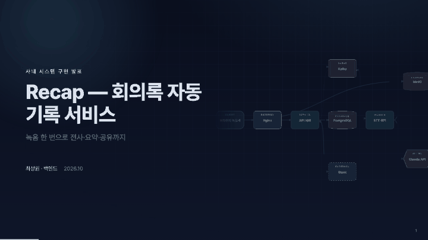

### 터미널 · 숫자 카운트업 · 벤토

명령어 타이핑 → 항목별 진행 막대와 `[OK]` 배지 → 숫자가 목표값까지 올라가는 지표 카드 → 시차를 두고 올라오는 카드.

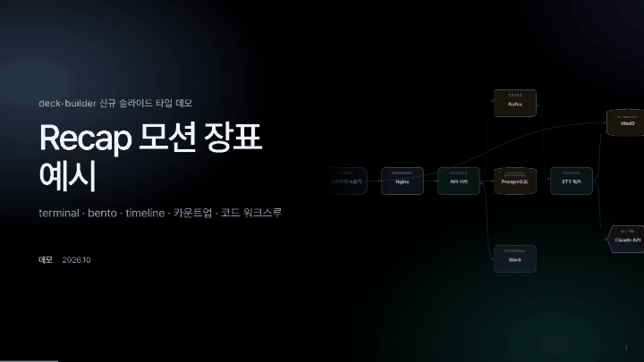

### 스크린샷 하이라이트 · 코드 매직무브 · 핵심 문장

제품 화면 위에서 영역을 하나씩 강조하고, 코드가 바뀔 때 바뀌지 않은 줄은 미끄러지며 새 줄만 나타납니다.

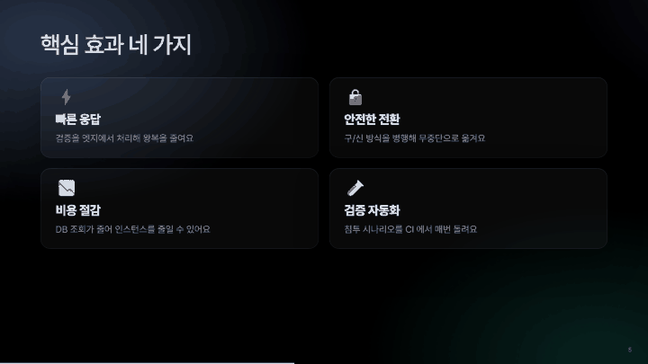

### 슬라이드 타입 한눈에

모든 스텝이 끝난 상태입니다.

<table>
<tr>
<td>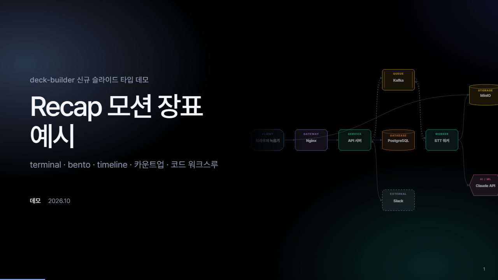<br><sub><code>title</code> — 배경에 토폴로지</sub></td>
<td>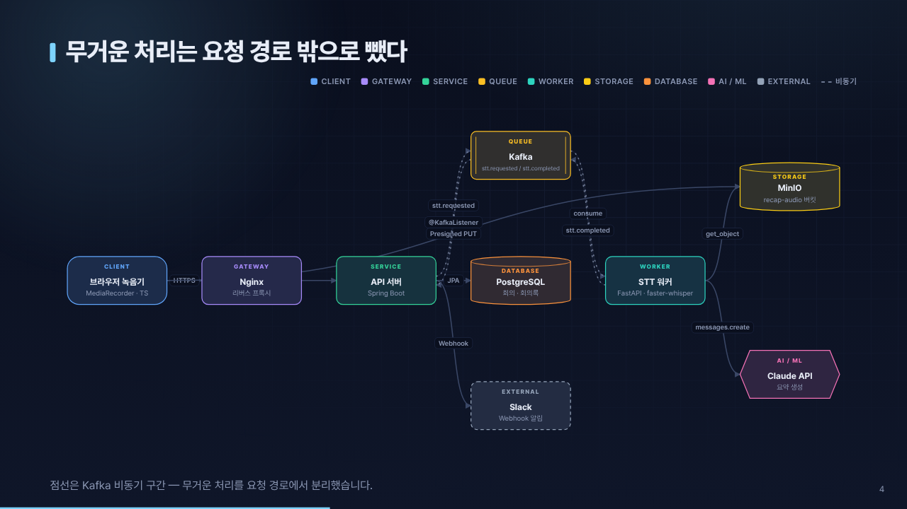<br><sub><code>topology</code> — 구성도</sub></td>
</tr>
<tr>
<td>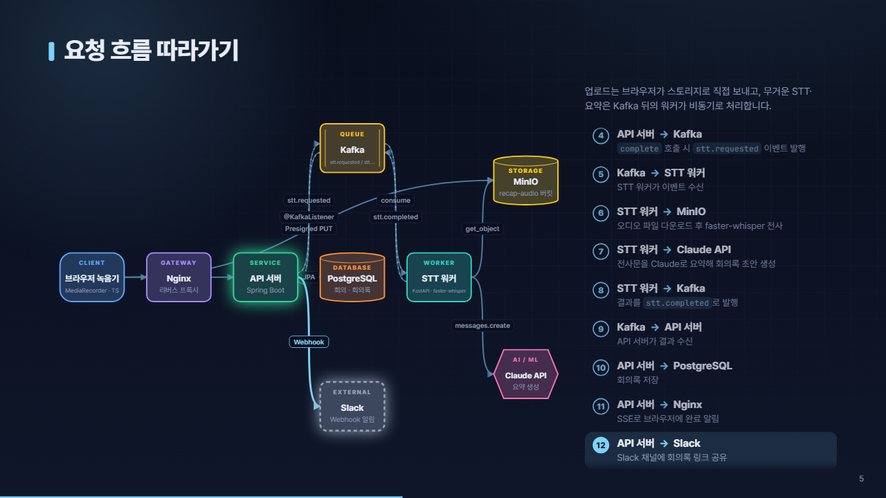<br><sub><code>flow</code> — 단계별 요청 흐름</sub></td>
<td>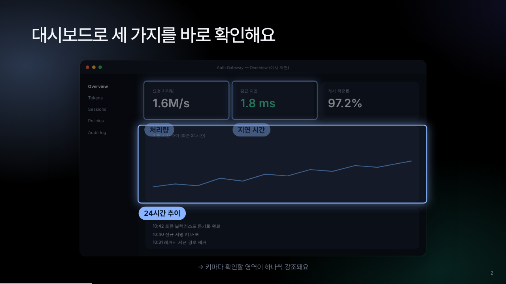<br><sub><code>image</code> — 스크린샷 + 하이라이트</sub></td>
</tr>
<tr>
<td>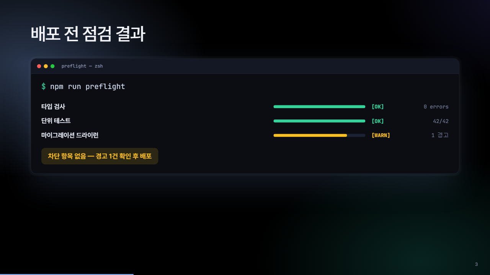<br><sub><code>terminal</code> — 점검·검증 현황</sub></td>
<td>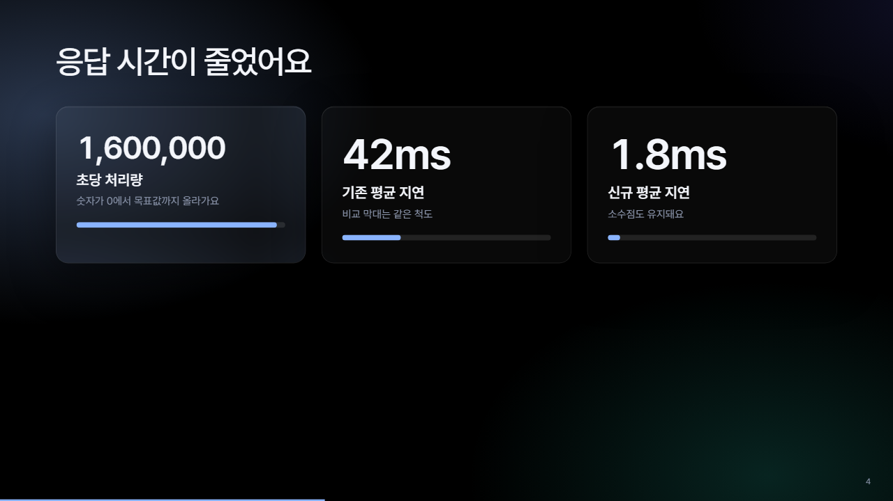<br><sub><code>stats</code> — 카운트업 + 비교 막대</sub></td>
</tr>
<tr>
<td>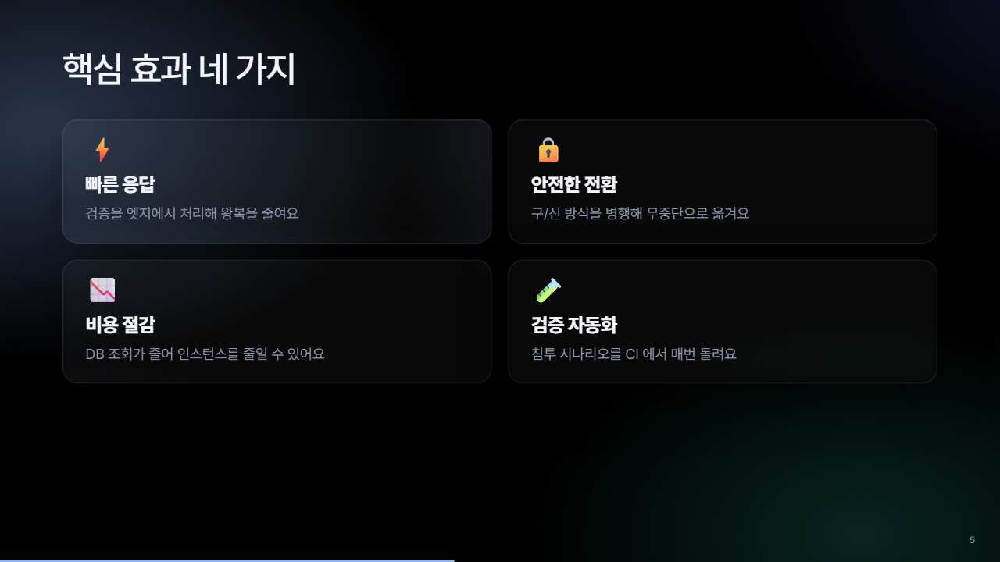<br><sub><code>bento</code> — 핵심 효과 요약</sub></td>
<td>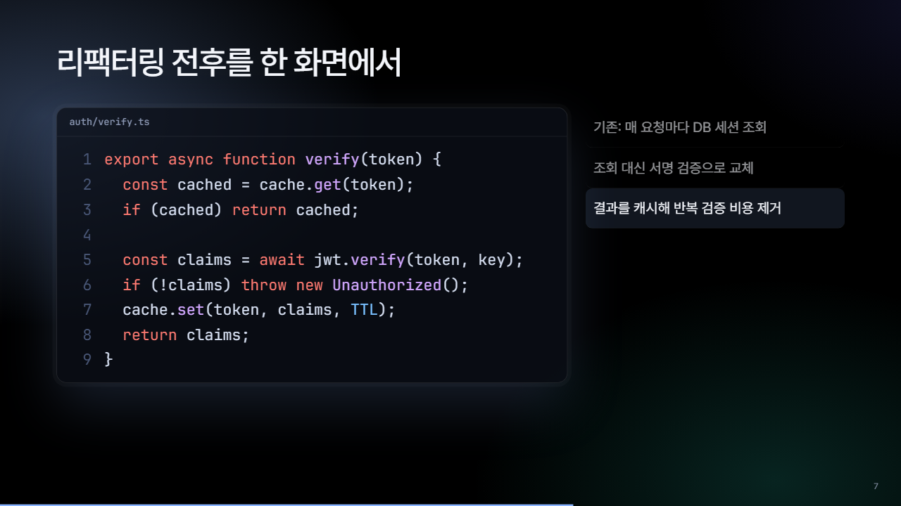<br><sub><code>code</code> + <code>magic</code> — 코드 모핑</sub></td>
</tr>
<tr>
<td>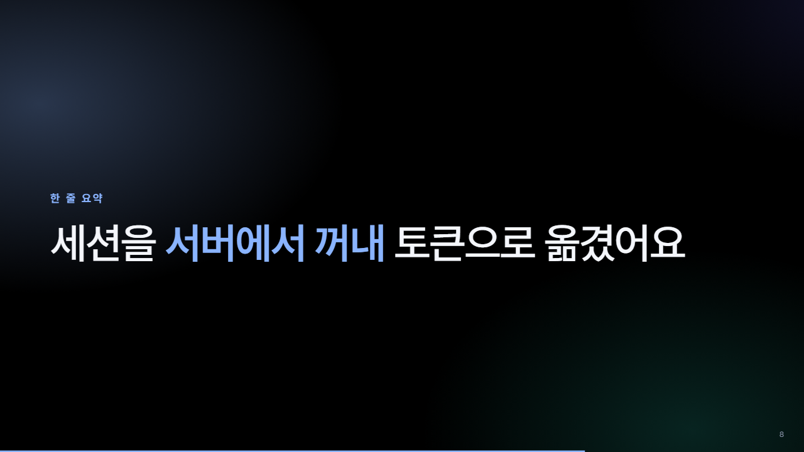<br><sub><code>statement</code> — 핵심 메시지</sub></td>
<td>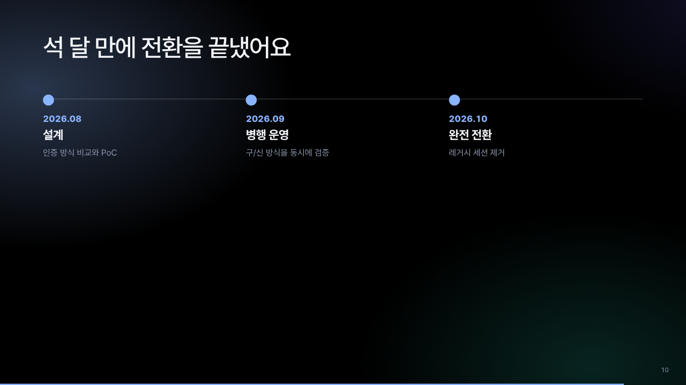<br><sub><code>timeline</code> — 구현 과정</sub></td>
</tr>
<tr>
<td>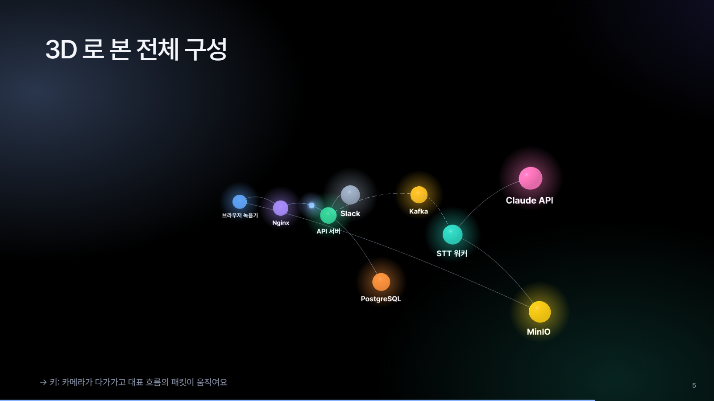<br><sub><code>scene</code> — Three.js 로 띄운 3D 구성도</sub></td>
<td>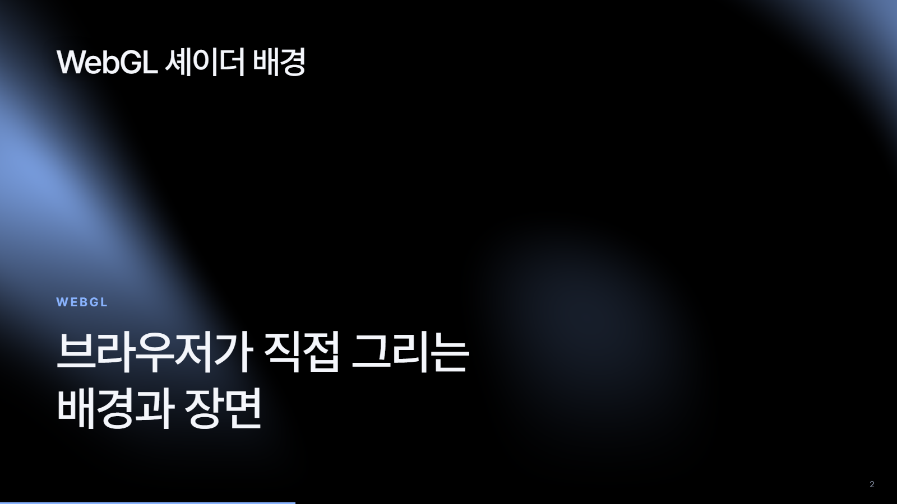<br><sub><code>scene</code> — WebGL 셰이더 배경</sub></td>
</tr>
</table>

`o` 키를 누르면 전체 슬라이드를 한눈에 보는 오버뷰가 열립니다.

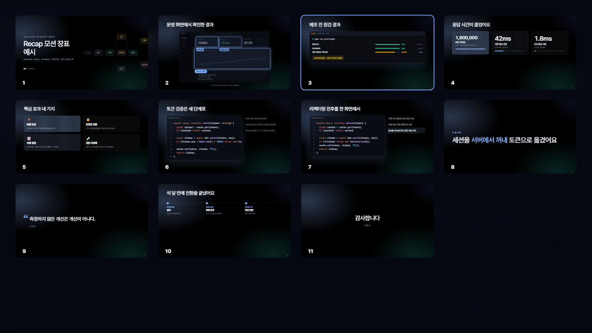

## 사용

```
/deck-builder:present                                        # 현재 저장소, 발표 맥락은 질문으로 받음
/deck-builder:present ../recap 경영진 대상 10분, toss 테마, 비동기 구조 강조
/deck-builder:present ../recap 기획서.hwpx 보고서.pdf 경영진 대상 10분   # 문서도 함께
```

명령어 없이 "이 저장소로 아키텍처 발표 장표 만들어줘"라고만 해도 됩니다. 만든 뒤에는 말로 고칩니다.

```
4번 슬라이드 제목 줄이고 stats 를 bento 로 바꿔줘
전체 구성을 Three.js 3D 로 보여 주는 scene 슬라이드 추가해줘
PDF 로도 뽑아줘
```

장표 수정은 `.deck/deck.json` 만 고치고 다시 빌드합니다. HTML 을 직접 고치면 다음 빌드에서 덮어써집니다.

### 발표 조작

| 키 | 동작 |
|---|---|
| `→` · `Space` / `←` | 다음 / 이전 (모바일은 스와이프) |
| `o` | 전체 슬라이드 보기 |
| `s` | 발표자 노트 |
| `f` | 전체화면 |
| `t` | 테마 전환 (aurora → dark → light → toss) |

## 동작 흐름

1. 발표 맥락(청중·원하는 행동·시간·강조점) 확정 — 빠진 것만 질문
2. `scan_repo.py` 로 진입점·연동·설정·배포·git 이력 1차 정찰 (문서가 있으면 `ingest.py` 로 변환)
3. `system-explorer`(구조 → `system-model.json`)와 `workflow-historian`(이력·문서 → `story.json`) 병렬 실행
4. 핵심 메시지 한 문장 → 청중별 프레임 선택 → 주장형 제목 목록(`outline.md`) → 헤드라인 테스트 → **사용자 확인** → `deck.json` 작성
5. 빌드 → 헤드리스 스크린샷을 직접 보고 겹침·잘림 수정 (최대 3회)
6. `deck-reviewer` 가 근거 없는 주장·코드 불일치와 제목 흐름 끊김을 찾아냄 → 수정
7. HTML(+PDF/PPTX) 전달, 핵심 메시지와 `[확인 필요]` 목록 보고

## 슬라이드 타입

| 분류 | 타입 |
|---|---|
| 구조 | `title` · `section` · `end`(`asks` 로 요청·다음 행동 목록) |
| 시스템 | `topology`(자동 순환 흐름, 포커스, 부분집합) · `flow`(한 단계씩 패킷 이동 + 단계 패널) |
| 내용 | `bullets` · `split` · `statement` · `quote` · `bento` · `timeline` |
| 근거·결과 | `stats`(카운트업 + 비교 막대) · `terminal`(타이핑 + 진행 막대 + `[OK]` 배지) · `image`(스크린샷 + 단계별 하이라이트) |
| 코드 | `code`(라인 강조 / `walk` 단계 포커스 / `magic` 줄 모핑) |
| 직접 그리기 | `scene`(GSAP · Canvas · SVG · WebGL · Three.js) |

필드는 [`references/deck-schema.md`](skills/system-deck/references/deck-schema.md) 에 있습니다. 예시: `examples/recap/deck-motion.html`(모션 타입 전반), `deck-scene.html`(scene 4종).

### scene — 웹 그래픽으로 직접 그리기

정해진 타입으로 표현하기 어려운 시각화는 JS 로 그립니다. 런타임이 고해상도 캔버스, 프레임 루프, 테마 색, 시스템 모델(`ctx.model`)을 넘겨 주고, 슬라이드를 떠나면 GSAP 애니메이션을 되돌리며, 스크린샷·PDF 에서는 최종 상태 한 프레임을 그립니다.

```jsonc
{ "type": "scene", "title": "3D 로 본 전체 구성",
  "libs": ["three", "gsap"], "script_file": "scenes/topology-three.js",
  "steps": 1, "fallback": "Three.js 를 불러오지 못했습니다" }
```

```js
// scenes/*.js — async function(ctx){ … } 의 본문
const g = ctx.canvas2d();
ctx.loop((t, dt) => { /* 매 프레임 그리기 */ });
return { step(k, still) { /* → 키 k 단계 */ } };
```

## 문서도 입력으로

문서를 주면 먼저 Markdown 과 표 JSON 으로 변환하고, 표는 `stats`/`timeline`/`terminal`/`bento` 슬라이드로 바꿉니다. 수치에는 `"기획서.hwpx 표 2"` 같은 출처가 붙습니다.

```bash
python skills/system-deck/scripts/ingest.py 기획서.hwpx -o .deck      # 변환만 따로 할 때
```

| 형식 | 처리 |
|---|---|
| `.hwpx` | 내장 파서(의존성 없음). 문단·표·중첩 표 |
| `.hwp` | `pip install pyhwp` (표 보존 안 됨 — `.hwpx`/PDF 로 저장 권장) |
| `.pdf .pptx .docx .xlsx` | `pip install "markitdown[all]"` |
| `.md .txt` | 그대로 |

스캔 이미지 PDF 는 텍스트가 없어 변환되지 않습니다(OCR 미지원).

## 테마

| 테마 | 인상 |
|---|---|
| `aurora` (기본) | 검은 배경 위로 천천히 흐르는 블러 그라데이션, 가벼운 큰 제목, 유리 카드. Slidev 쇼케이스(Neko·antfu 덱)를 참고 |
| `dark` | 격자 배경의 기술 공유용 |
| `light` | 밝은 프로젝터·인쇄용 |
| `toss` | 흰 배경, 블루 포인트(#3182f6), 큰 굵은 타이포, 카드형 불릿. Toss Product Sans 는 비공개 서체라 Pretendard 로 대체하며 로고·상표는 넣지 않음 |

## 모션

슬라이드 전환(`slide-left`/`slide-up`/`zoom`/`fade`, 방향 인식), 스텝 등장 프리셋(`up`/`left`/`right`/`scale`/`fade`), 제목의 단어 단위 등장, 스프링 이징, 코드 매직무브, 숫자 카운트업, 터미널 타이핑, 천천히 흐르는 배경 글로우를 지원합니다. `prefers-reduced-motion` 환경에서는 모션을 끄고 최종 상태를 보여 줍니다.

## 내보내기와 오프라인

- **PDF**: 브라우저 인쇄 또는 `render_check.py --pdf`
- **PPTX**: `python skills/system-deck/scripts/export_pptx.py deck.html` — 슬라이드별 최종 상태 이미지 + 발표자 노트 (모션·텍스트 편집 불가, 제출용)
- **오프라인**: 결과 HTML 은 인터넷 없이 동작합니다. Pretendard 웹폰트와 코드 하이라이트(highlight.js)는 온라인일 때만 CDN 에서 불러오고, 없으면 시스템 한글 폰트와 무채색 코드로 표시됩니다. 단 `scene` 의 CDN 라이브러리(`gsap`, `three`)는 오프라인에서 로드되지 않아 `fallback` 문구가 보이므로, 오프라인 발표라면 라이브러리 파일을 `{"name", "src"}` 로 지정해 HTML 에 내장하세요

## 구성

```
deck-builder/
├─ .claude-plugin/                 # plugin.json, marketplace.json
├─ commands/present.md             # /deck-builder:present
├─ agents/
│  ├─ system-explorer.md           # 코드·설정 → system-model.json (노드/간선/흐름 + 파일:라인 근거)
│  ├─ workflow-historian.md        # git 이력·문서 → story.json (문제·결정·타임라인·지표 + 출처)
│  └─ deck-reviewer.md             # 완성 장표의 사실 문장을 원문과 독립 대조 + 제목 흐름 점검
├─ skills/system-deck/
│  ├─ SKILL.md                     # 7단계 오케스트레이션
│  ├─ references/                  # 모델·장표 스키마, 청중별 스토리 프레임·제목·문장 규칙
│  ├─ scripts/
│  │  ├─ scan_repo.py              # 결정적 1차 정찰 (Spring/FastAPI/Express/compose/k8s/git)
│  │  ├─ ingest.py                 # 문서(HWPX/PDF/PPTX/DOCX/MD) → source.md + 표 JSON
│  │  ├─ build_deck.py             # deck.json + model → HTML (검증·린트 포함, 표준 라이브러리만 사용)
│  │  ├─ deck_template.html        # 슬라이드 엔진 + 토폴로지 애니메이션 + scene 런타임
│  │  ├─ render_check.py           # 헤드리스 검수: 스크린샷, 넘침, 콘솔 에러, PDF
│  │  └─ export_pptx.py            # 장표 → 이미지 PPTX (발표자 노트 포함)
│  └─ examples/recap/              # 예시 모델·장표·scene 스크립트와 빌드 결과
├─ tools/                          # README 미디어 녹화, GitHub Pages 데모 생성
└─ tests/
```

## 개발

```bash
python -m unittest discover -s tests                                   # 테스트
python skills/system-deck/scripts/build_deck.py deck.json --strict     # 경고까지 실패로 처리하는 빌드
```

- `tools/record_media.py` — README 미리보기 미디어(`docs/media/`) 재생성 (`pip install playwright pillow`)
- `tools/publish_demo.py` — 예시 장표를 다시 빌드해 GitHub Pages 데모(`docs/demo/`)로 복사. Pages 는 `master` 의 `/docs` 를 서빙합니다
